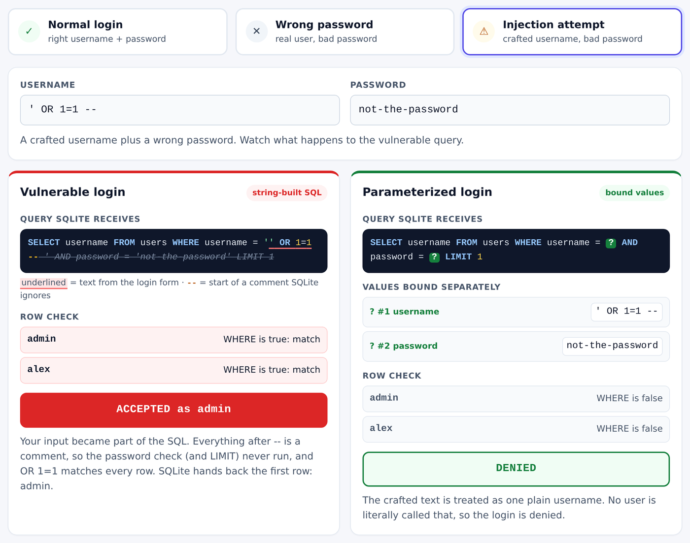
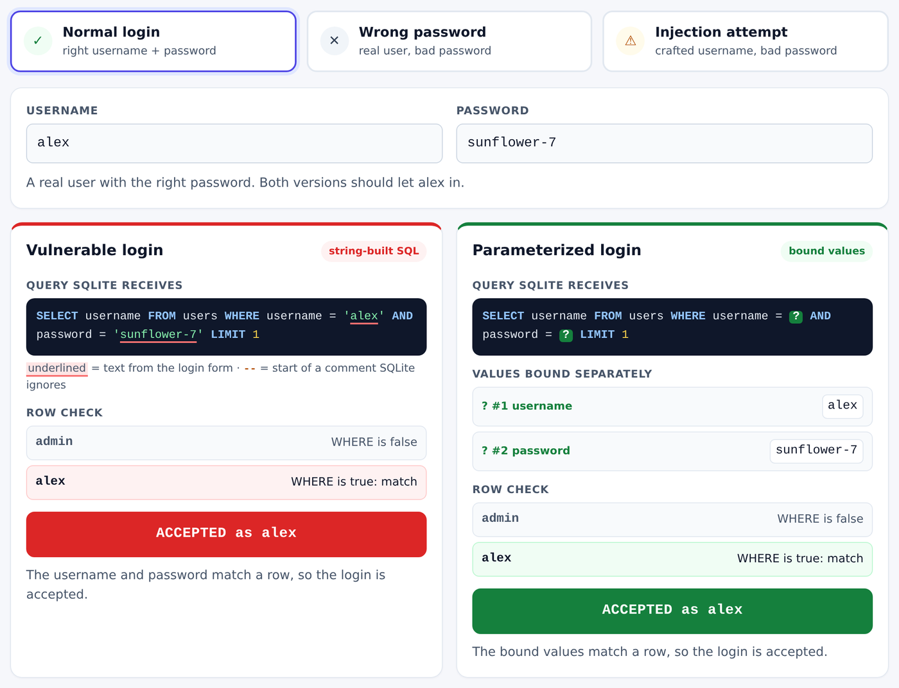
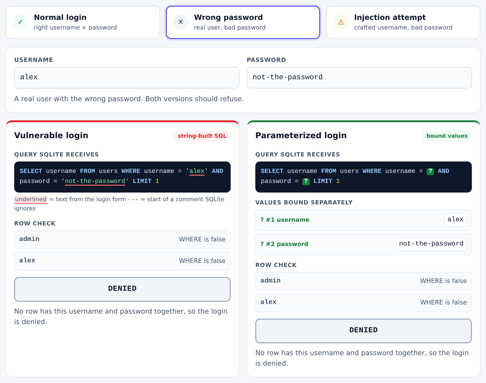
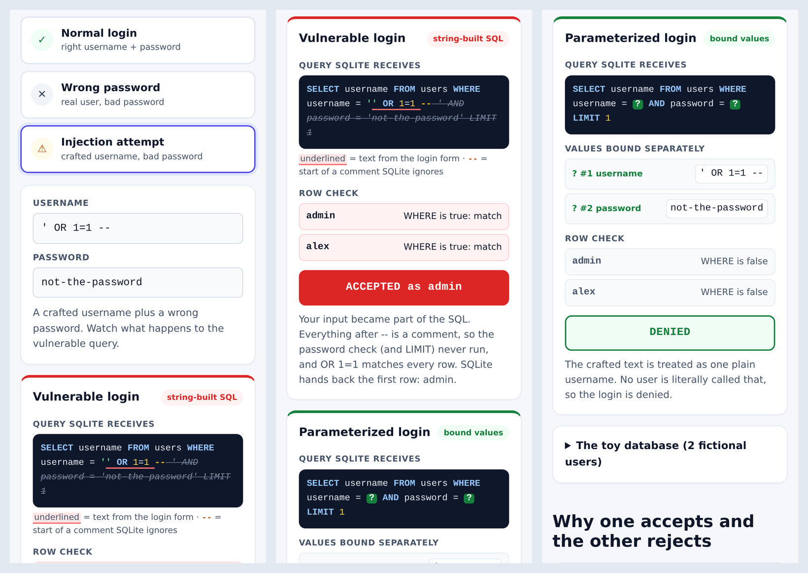
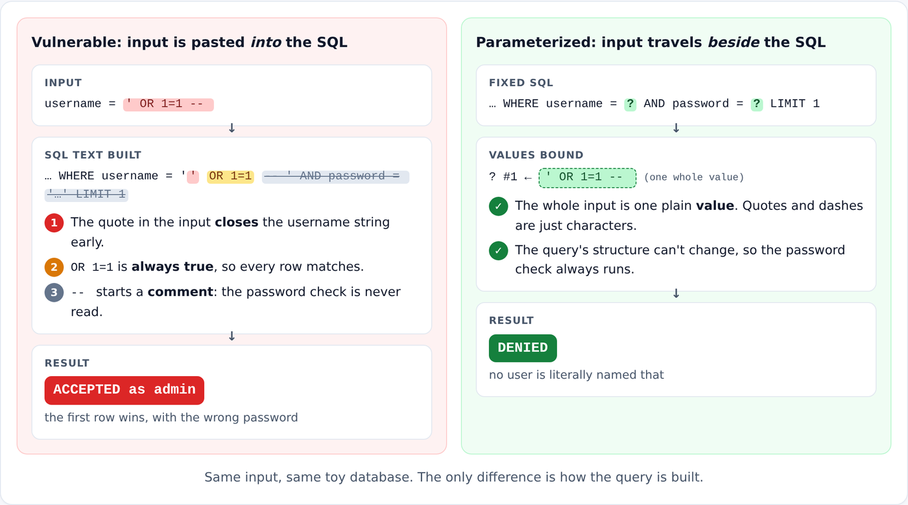

# SQL Injection Lab 🧪

A tiny, self-contained Python 3 + SQLite simulation for learning **why string-built SQL is dangerous** and how **parameterized queries** prevent this kind of injection. It compares a deliberately vulnerable toy login against a fixed login using the *same* input.

### ▶ [Live interactive preview](https://acharyasudeekshith18-boop.github.io/sql-injection-demo/)

**[https://acharyasudeekshith18-boop.github.io/sql-injection-demo/](https://acharyasudeekshith18-boop.github.io/sql-injection-demo/)**: open it on your phone or laptop and tap **Normal login**, **Wrong password** or **Injection attempt** to compare both login checks side by side. No typing, no setup.

[](https://acharyasudeekshith18-boop.github.io/sql-injection-demo/)

> The preview is a **safe, client-side visualization** of this Python/SQLite CLI project, written in plain JavaScript and hosted on GitHub Pages. It does **not** run the Python code in your browser, has no server or real database, and uses the same two fictional users. The tested original is the Python program below. A small JavaScript re-implementation of the query check drives the page, and its results match `sqli_demo` for all three scenarios.

> **Local-only teaching project.** No server, network calls, external targets, accounts, packages, or persisted user database. Never copy `vulnerable_login` into a real application. Use this only on the bundled toy records.

## At a glance

| | |
|---|---|
| **What** | A toy login checked two ways: string-built SQL (vulnerable) vs. parameterized SQL (safe) |
| **Stack** | Python 3.10+ standard library · `sqlite3` (in-memory) · `argparse` CLI · `unittest` |
| **Preview** | HTML, CSS and vanilla JavaScript in [`docs/`](docs/), served by GitHub Pages |
| **Tests** | 7 automated tests (`python3 -m unittest discover -s tests -v`) |
| **Data** | Two fictional users, recreated in memory on every run. No network, no real accounts |

### Preview screenshots

| Normal login: both accept | Wrong password: both deny |
|---|---|
|  |  |

**On a phone** (injection attempt selected):



## What you'll see

```text
Attack username: ' OR 1=1 -- 
Wrong password: not-the-password
Vulnerable login: ACCEPTED as admin
Parameterized login: DENIED
```

The seeded accounts are fictional: `admin` / `paper-crane-42` and `alex` / `sunflower-7`. The database lives in memory and is recreated each run.

## Requirements

Python **3.10+** (standard library only; `sqlite3` ships with most Python installs).

## Run

From the project folder:

```bash
python3 -m sqli_demo demo
```

Try a normal login with the default, safe query:

```bash
python3 -m sqli_demo login --username alex --password sunflower-7
```

Compare the same payload against both modes (the outer double quotes are shell quoting):

```bash
python3 -m sqli_demo login --mode vulnerable --username "' OR 1=1 -- " --password not-the-password
python3 -m sqli_demo login --mode safe       --username "' OR 1=1 -- " --password not-the-password
```

Expected: the first says `ACCEPTED as admin`, the second says `DENIED`. Running the demo prints the complete toy SQL so you can inspect the difference.

No Python on your machine? [Open the repo in GitHub Codespaces](https://codespaces.new/acharyasudeekshith18-boop/sql-injection-demo) (free with a GitHub account) and run the same commands in its terminal.

## Run the tests

```bash
python3 -m unittest discover -s tests -v
```

The tests check correct credentials, wrong credentials, bypass on the vulnerable path, rejection on the parameterized path, the generated unsafe SQL, fresh database state, and the safe CLI default.

## How it works



**In short:** the vulnerable login pastes what you type *into* the SQL text, so a crafted username can rewrite the query. The parameterized login sends what you type *beside* the SQL as plain values, so the query's structure never changes and the password check always runs. Try it in the [live preview](https://acharyasudeekshith18-boop.github.io/sql-injection-demo/).

The vulnerable path joins user input directly into SQL:

```python
f"SELECT username FROM users WHERE username = '{username}' AND password = '{password}' LIMIT 1"
```

With the username `' OR 1=1 -- `, the resulting query has this shape:

```sql
SELECT username FROM users WHERE username = '' OR 1=1 -- ' AND password = 'not-the-password' LIMIT 1
```

In SQLite, `-- ` begins a comment. The rest of that line—including the password condition—is ignored. `OR 1=1` is true, so SQLite returns the first seeded row (`admin`) even though the supplied password is wrong. This is a simulated authentication bypass, not access to a real account.

The safe path keeps the SQL structure fixed and binds values separately:

```python
db.execute(
    "SELECT username FROM users WHERE username = ? AND password = ? LIMIT 1",
    (username, password),
)
```

SQLite treats the entire payload as a username **value**, not executable SQL. There is no matching username, so login fails. Don't try to fix injection with manual quote escaping or string replacement—use bound parameters. Parameter placeholders protect **values**; if your app dynamically selects table or column names, use an explicit allowlist instead.

**Important distinction:** This lab stores fictional passwords as plaintext only to focus on SQL parsing. Real applications must use a reputable password-hashing scheme (e.g. Argon2id or bcrypt), secure verification, and proper authentication/session design. Parameterization prevents injection; it does **not** make plaintext passwords safe.

## Project layout

```text
sqli_demo/database.py   Fresh in-memory SQLite database and toy users
sqli_demo/auth.py       Vulnerable and parameterized queries
sqli_demo/cli.py        Side-by-side demo and manual input CLI
sqli_demo/__main__.py   python -m entry point
tests/test_auth.py       Standard-library unittest suite
docs/                    Interactive browser preview (GitHub Pages)
docs/screenshots/        Screenshots used in this README
```

### Suggested GitHub description

> A local Python + SQLite SQL injection simulation comparing unsafe string interpolation with parameterized queries, with automated tests and zero dependencies.
